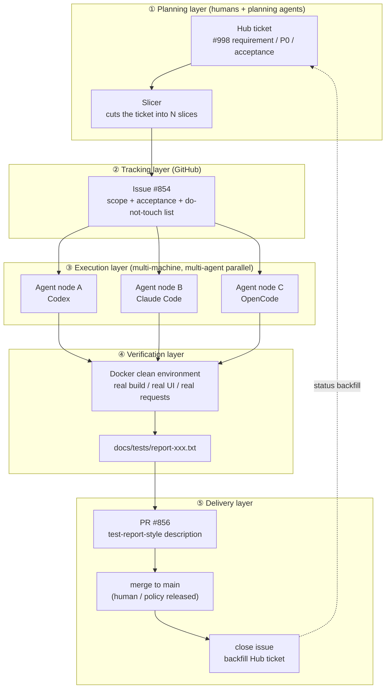

> **Playbook: Issue-Driven Multi-Agent Delivery Pipeline**
>
> Version: v1.0 · For: individuals / small teams who want high-throughput development via "task slicing + coding agents + automated closed loops"
>
> Reference prototype: the public workflow of `sleep2agi/agent-network` (Hub ticket → sliced issues → executed by Codex / Claude Code etc. → verified inside Docker → test-report-style PR → auto-merge → close issue)

---

## 0. TL;DR (30 seconds)

1. **Carry the requirement in a single "Hub ticket"**, and slice it into N "slices" that can each close their own loop.
2. **One slice = one GitHub Issue**, with scope, acceptance criteria and forbidden actions written explicitly into the issue description.
3. **Each issue goes to one coding agent** (Codex / Claude Code / OpenCode / any CLI agent), which follows a fixed SOP: create branch → write code → self-test in Docker → generate test report → open PR → merge → close issue.
4. **The PR description is not vibes for humans; it is a machine-checkable test report** (which cases ran, how many passed, where the report file lives, boundary declarations).
5. **Multiple machines / multiple agents in parallel**, claiming slices by directory or module to avoid stepping on each other.
6. **The numbers are a by-product**: one slice automatically yields 3~5 GitHub contribution squares (1 issue + 1 PR + 1~3 commits); 50~70 slices a day means 200~300 squares in a single day.

---

## 1. What this pipeline actually does

### 1.1 The phenomenon

One account shows 200~300 contributions in a single day on its GitHub contribution graph and 7,655 in a year. The breakdown is roughly:

| Type | Share | Meaning |
|---|---|---|
| commits | ~58% | branch commits + squash commits merged into trunk |
| pull requests | ~35% | one PR per slice |
| issues | ~7% | one issue per slice (plus the Hub ticket) |
| code review | 0% | humans write no reviews (bot reviews don't count as human contributions) |

### 1.2 The essence

**It is not that humans type fast — it is that "work units" are standardized and handed to agents for batch execution. Humans only do three things: split the task, define acceptance, and release the merge.**

Key insights:

- The GitHub contribution graph **counts commits / PRs / issues / reviews separately**. The same work unit gets counted 3~5 times.
- The pipeline runs **24/7** — agents work while humans sleep.
- Quality does not come from "reading it over more times"; it comes from **reproducible verification scripts + retained test reports**.

### 1.3 Breaking down the numbers (work out the math before setting goals)

Typical output of one slice:

```
1 issue             = 1 square
1 branch commit     = 1 square
1 commit merged to main = 1 square
1 PR                = 1 square
────────────────────────────
total               ≈ 4 squares (3~5 depending)
```

| Target | Slices to complete | Notes |
|---|---|---|
| 100 squares/day | ~25 slices/day | a single agent + human on duty is enough |
| 250 squares/day | ~60 slices/day | 2~4 agents in parallel + auto-merge |
| 300+ squares/day | ~70 slices/day | multiple machines and agents + a release sprint |

> ⚠️ Contribution squares **≠** output value. The legitimate purpose of this pipeline is "throughput", not "greenwashing". Take the quality gates of §13 along with it, or you are just mass-producing garbage.

---

## 2. Core design principles

| # | Principle | What it means in practice |
|---|---|---|
| P1 | **Slices small enough to close in one pass** | ≤ 500 changed lines, ≤ 2 agent-hours, independently mergeable |
| P2 | **The issue is the single source of truth** | verbal requests become Hub tickets first, then slices; no "just fix it while you're at it" |
| P3 | **Acceptance first** | write down "how we know it's done" before writing code (executable check commands preferred) |
| P4 | **Verification must be reproducible** | run everything in Docker / a clean environment; commands go into scripts, results go into report files |
| P5 | **PR description = test report** | machine-checkable: what ran, how many passed, where the report is, what was not done |
| P6 | **Artifacts beat words** | commit report files (`docs/tests/report-*.txt`), reference their paths in the PR |
| P7 | **Parallelism through isolation** | one slice per directory / module; slices sharing files must be serialized with locks |
| P8 | **Merge authority stays human, pace stays mechanical** | agents may open PRs and run verification, but the merge button is released by a human or an explicit policy |
| P9 | **Boundary declarations** | every PR states "what this change does NOT do", preventing agents from touching production config / secrets |
| P10 | **Numbers thread through everything** | the Hub ticket number appears in branch names, commits, PR titles and report filenames — fully traceable |

---

## 3. Overall architecture

### 3.1 Architecture diagram



### 3.2 Component inventory

| Component | Responsibility | Possible implementations |
|---|---|---|
| Hub ticket store | requirements, priority, version, acceptance | GitHub Project / issues of a dedicated repo / Notion / Feishu Base |
| Slicer | cut tickets into closeable slices | a human, or "planning agent + human confirmation" |
| Execution agent | branch, code, self-test, open PR | Codex CLI / Claude Code / OpenCode / Aider / custom orchestration |
| Verification environment | reproducible real verification | Docker Compose (recommended) / clean local VM / CI job |
| Report artifacts | archive test results | commit `docs/tests/report-*.txt` |
| Automation tooling | create issues / open PRs / merge / close issues | `gh` CLI + scripts + GitHub Actions |
| Review bot | machine pre-review | `chatgpt-codex-connector` / GitHub Copilot code review / custom reviewer agent |
| Multi-machine orchestration | dispatch work in parallel | `sleep2agi/agent-network` (reference implementation) / custom queue (Redis, file locks all work) |

### 3.3 Recommended repository layout

```text
your-repo/
├── .github/
│   ├── ISSUE_TEMPLATE/
│   │   ├── slice.yml            # slice issue template
│   │   └── hub-ticket.yml       # Hub ticket template
│   ├── PULL_REQUEST_TEMPLATE.md # test-report-style PR template
│   └── workflows/
│       ├── slice-verify.yml     # per-slice verification pipeline
│       └── auto-merge.yml       # auto-merge after gates pass (optional)
├── docs/
│   ├── hub/                     # Hub tickets and slice ledger
│   │   └── 998-reauth-loop.md
│   ├── tests/
│   │   └── report-test998-reauth-race.txt   # test report artifact
│   └── playbooks/
│       └── agent-sop.md         # this playbook (copy inside the repo)
├── scripts/
│   ├── slice-start.sh           # start: create branch
│   ├── slice-verify.sh          # one-shot verification (local + Docker)
│   ├── slice-deliver.sh         # open PR + merge + close issue
│   └── locks/                   # directory-level serialization locks (parallel conflict control)
├── AGENTS.md                    # repo rules for agents (important!)
├── CLAUDE.md                    # rule files for each agent family (as needed)
└── ...
```

---

## 4. Prerequisites

### 4.1 Accounts and permissions

- [ ] A dedicated GitHub account (optional but recommended): separate the "human account" from the "pipeline account" for auditing and rate-limit isolation.
- [ ] Enable GitHub's **noreply email** and configure git with it, so commits count toward the contribution graph:

```bash
git config --global user.name  "your-username"
git config --global user.email "yourID+username@users.noreply.github.com"
# Find the address under GitHub → Settings → Emails; it looks like 25839884+username@users.noreply.github.com
```

- [ ] Repo permissions: the pipeline account needs `write` (create branches, push, open PRs) and `triage` (open/close issues). Whether merge rights are delegated: see §13.
- [ ] Install GitHub CLI and log in:

```bash
gh auth login
gh auth status
```

- [ ] Create a fine-grained PAT / or just use `gh auth token`: scopes at least `repo`, `workflow` (if Actions changes are needed).
- [ ] If using bot reviews: install the `chatgpt-codex-connector` GitHub App or Copilot code review.

### 4.2 Machine environment (every agent node needs this)

- git ≥ 2.40, Node.js ≥ 22 (for Codex/OpenCode), Python 3.11+ (if needed)
- Docker Desktop / Docker Engine (mandatory for the verification layer)
- One coding-agent CLI, fully logged in (`codex login` / `claude auth login`, etc.)
- (Optional) `jq`, `yq` for JSON handling

> Windows tip: run the scripts in **WSL2 or Git Bash**; PowerShell works too, but bash scripts are directly reusable. Commands below are bash-first; PowerShell equivalents are in Appendix B.

### 4.3 Repository setup

**Labels (recommended)**

```bash
gh label create slice        --color 0E8A16 --description "a slice that can close its own loop"
gh label create hub/998      --color 1D76DB --description "belongs to Hub ticket 998"
gh label create p0           --color D93F0B --description "P0"
gh label create needs-review --color FBCA04 --description "waiting for human release"
gh label create auto-merged  --color 5319E7 --description "auto-merged after gates passed"
```

**Branch protection (`main`)**

- At minimum: forbid force push / branch deletion; merges only via PR; the `slice-verify` status check must pass.
- If you allow the high-throughput mode where "2 of 18 checks passing is enough to merge" (see §13.3), narrow the mandatory checks to **1~2 core jobs** (unit tests + typecheck) and make the rest non-blocking.

**`AGENTS.md` (the repo constitution for all agents — write it, always)**

```markdown
# AGENTS.md

## Must read
1. Only do what is inside the current issue's "slice scope"; if you spot other problems → write them into "Known issues", do not fix them on the side.
2. Forbidden to change: production config, secrets, deployment scripts, release files (unless the issue explicitly asks for it).
3. All verification must run `scripts/slice-verify.sh`, with results written to `docs/tests/report-<slice>.txt`.
4. Commit message format: `type(scope): subject (#<hub>)`; ≤ 3 commits per slice.
5. PR description uses `.github/PULL_REQUEST_TEMPLATE.md`; test numbers must match the report file.
6. Merge policy: do not click merge yourself unless all checks are green and the issue is labeled `auto-merge`.
```

### 4.4 One-shot preflight script

```bash
#!/usr/bin/env bash
# scripts/preflight.sh — agent preflight before starting work
set -euo pipefail
command -v git  >/dev/null || { echo "git missing";    exit 1; }
command -v gh   >/dev/null || { echo "gh missing";     exit 1; }
command -v docker >/dev/null || { echo "docker missing"; exit 1; }
gh auth status || { echo "gh not logged in"; exit 1; }
git config user.email >/dev/null || { echo "git email not configured"; exit 1; }
echo "OK: environment ready"
```

---

## 5. Ticket system (Hub)

### 5.1 Three-layer structure

```
Hub ticket (requirement / version level, e.g. #998)
   └── Slice issue (closeable delivery unit, e.g. agent-network-app#854)
         └── PR (implementation + test report, e.g. #856) → merge → close
```

One Hub ticket can be sliced across multiple repos (e.g. `#998` sliced into both `agent-network` and `agent-network-app`). The Hub number travels all the way into branch names and PR titles.

### 5.2 Hub ticket template

```markdown
## Hub #<id> · <one-line title>
- Priority: P0 / P1 / P2
- Target version: <e.g. 0.2.241>
- Background: <user feedback / business goal, 3~5 lines>
- Repro / current state: <how the problem was observed, including environment>
- Overall acceptance criteria:
  - [ ] <executable acceptance 1>
  - [ ] <executable acceptance 2>
- Slice plan:
  - [ ] Slice 1: <title> → <target repo / module>
  - [ ] Slice 2: <title> → <target repo / module>
- Explicitly out of scope: <boundaries, prevent scope creep>
- Release requirements: <version number, which SHA to build from, rollout scope>
```

### 5.3 Slicing rules (how to slice so slices can close)

A qualified slice = **independently mergeable + independently verifiable + independent of other slices**.

| Rule | Explanation | Counter-example |
|---|---|---|
| One behavior per slice | e.g. "fix the expired-401 re-login loop" is one slice | "refactor the auth module" is too big |
| Controllable diff | ≤ ~500 changed lines, ≤ 5 files ideally | one PR touching 30 files |
| Executable acceptance | "run `npm test -- reauth`, 10/10 pass" | "smooth experience" |
| Explicit dependencies | if it depends on another slice, say "merge slice N first" | verbally "wait for theirs" |
| Clear boundaries | write "don't touch A, don't move B" | if not written, agents will wander |
| Ticket number in the name | `fix/998-reauth-late-401` | `fix-bug2` |

### 5.4 Slice issue template (`.github/ISSUE_TEMPLATE/slice.yml`)

```yaml
name: Slice
description: A work slice that can close its own loop
title: "[slice] <title> (#<hub>)"
labels: ["slice"]
body:
  - type: textarea
    id: hub
    attributes:
      label: Parent Hub ticket
      description: e.g. Hub #998 (ANet / knowledge base, P0)
    validations:
      required: true
  - type: textarea
    id: scope
    attributes:
      label: Slice scope (only do these)
      placeholder: |
        1. …
        2. …
    validations:
      required: true
  - type: textarea
    id: accept
    attributes:
      label: Acceptance criteria (executable)
      placeholder: |
        - [ ] `scripts/slice-verify.sh <slice>` all green
        - [ ] real UI flow in Docker 8/8 PASS
    validations:
      required: true
  - type: textarea
    id: forbidden
    attributes:
      label: Forbidden changes
      placeholder: |
        - production config / secrets / deployment scripts
        - do not create real production data
  - type: textarea
    id: env
    attributes:
      label: Repro and verification environment
      placeholder: Docker image, account requirements, test data sources (synthetic data recommended)
```

Real-world example (excerpt from a live pipeline):

```markdown
Hub #998 (ANet / knowledge base, P0). Users report that on Android 0.2.239, after a
successful re-login they land back on the login page; cold start chats fine but the
account still shows re-login required. This slice only: accept replacement credentials
after persistence, serialize save/reauth marks, verify request-token ownership, guard
pending reauth callbacks. Acceptance: Docker core race 10/10, session registry 39/39,
password 66/66, full typecheck, real export UI 8/8 PASS. Forbidden: real password change,
native packaging, release. Next version 0.2.241 must be built from the exact main SHA.
```

### 5.5 State transitions

```text
Hub ticket:   Todo → Slicing → In Progress(slices executing) → Verify → Released → Closed
Slice issue:  Open → (agent starts) → PR opened → Merged → Closed (auto-closed by the PR)
```

Use `Closes #<issue>` so the PR closes the issue on merge; backfill the Hub side with scripts or GitHub Project automation.

---

## 6. Naming and conventions (ticket numbers thread through the chain)

| Object | Format | Example |
|---|---|---|
| Hub ticket | `Hub #<id>` | `Hub #998` |
| Slice issue title | `[slice] <verb phrase> (#<hub>)` | `[slice] stop stale401 re-login loop (#998)` |
| Branch name | `<type>/<hub>-<slug>` | `fix/998-reauth-late-401` |
| commit | `<type>(<scope>): <subject> (#<hub>)` | `fix(auth): isolate late unauthorized responses from fresh sign-in (#998)` |
| PR title | same as the commit subject | `fix(auth): stop stale401 re-login loop (#998)` |
| Test report | `docs/tests/report-<topic>-<slug>.txt` | `docs/tests/report-test998-reauth-race.txt` |
| Release branch | `release/<hub>-<desc>` | `release/906-provider-pair-166-132-124` |
| Ops branch | `ops/<hub>-<desc>` | `ops/906-hub121-preflight` |

**commit type reference**: `feat` `fix` `refactor` `test` `docs` `ci` `chore` `perf` `build`

**Hard rules**:

1. The Hub number must appear in branch names, commits, PR titles and report filenames (traceability).
2. ≤ 3 commits per slice; more means the slice was cut too big.
3. Commit messages like `update` / `fix bug` / `wip` are forbidden.

---

## 7. Standard operating procedure for one slice (SOP)

> Goal: a competent agent + this SOP can close a slice in **30~90 minutes**. The table below is the time budget.

| Step | Action | Input | Output | Budget |
|---|---|---|---|---|
| S0 | Preflight | Issue | environment OK | 2 min |
| S1 | Claim slice | issue list | lock acquired, claim comment posted | 1 min |
| S2 | Read the issue carefully | Issue | clear scope / acceptance / forbidden list | 5 min |
| S3 | Create branch | naming rules | `fix/998-xxx` | 1 min |
| S4 | Write verification first | acceptance criteria | failing tests / scripts | 10 min |
| S5 | Implement | scope | diff | 20~40 min |
| S6 | Verify in Docker | `slice-verify.sh` | all green | 10~20 min |
| S7 | Generate test report | verification output | `report-*.txt` | 5 min |
| S8 | Self-review (boundaries / leftovers) | diff | checklist | 5 min |
| S9 | Open PR | template | PR (test-report style) | 3 min |
| S10 | Machine review | bot | no blocking comments / fixes | 5~15 min |
| S11 | Release merge | gates | merged to main | 1~5 min |
| S12 | Wrap up | merge | close issue, backfill Hub, delete branch, record metrics | 3 min |

### S1 Claim the slice (conflict-safe for parallel work)

```bash
gh issue comment <n> --body "🔧 claimed by <agent-id> on <host> at $(date -u +%FT%TZ)"
# or use file locks (see §12)
```

### S3 Create the branch

```bash
git checkout main && git pull --ff-only
git checkout -b fix/998-reauth-late-401
```

### S4 Write verification first (very important)

- Translate the acceptance criteria into **executable commands**: unit tests, scripts, UI step lists.
- Run them once and **confirm they currently fail** (red) before writing code. This step prevents "testing nothing".

### S6 Verify in Docker (recommended shape)

```yaml
# docker/verify.compose.yml
services:
  verify:
    build: .
    volumes:
      - ./docs/tests:/app/docs/tests
    command: bash scripts/slice-verify.sh <slice>
    environment:
      - VERIFY_MODE=docker          # force a clean environment
      - SYNTHETIC_CREDENTIALS=1     # synthetic credentials only
```

```bash
docker compose -f docker/verify.compose.yml run --rm verify
```

Verification should cover (trim to your project):

- [ ] Unit tests (counted per module, e.g. `session registry 39/39`)
- [ ] Race/regression suites (e.g. `core race 10/10`)
- [ ] Full typecheck / lint
- [ ] Real build (real export, real packaging — not mocks)
- [ ] Critical-path UI/API smoke (e.g. `login/late401 UI 8/8`)
- [ ] Boundary check: forbidden files untouched (`git diff --name-only` against the list)

### S8 Self-review checklist

```markdown
- [ ] The diff contains nothing outside the "slice scope"
- [ ] No secrets, production config, or real user data
- [ ] Test numbers match the report file
- [ ] Report file is committed and referenced by the PR
- [ ] Leftover issues are written into the PR's "Known issues" section (not fixed on the side)
- [ ] ≤ 3 commits, messages follow the convention
```

### S12 Wrap up

```bash
gh pr merge <n> --squash --delete-branch   # or done by auto-merge
gh issue close <issue> --comment "Done, report: docs/tests/report-xxx.txt"
# Backfill the Hub ledger: mark the slice as Done
```

---

## 8. Automation scripts

### 8.1 `scripts/slice-start.sh` (start work)

```bash
#!/usr/bin/env bash
set -euo pipefail
ISSUE="${1:?usage: slice-start.sh <issue-number> <hub-number> <slug>}"
HUB="${2:?hub number}"
SLUG="${3:?slug}"
BR="fix/${HUB}-${SLUG}"

bash scripts/preflight.sh
git checkout main && git pull --ff-only
git checkout -b "$BR"

gh issue comment "$ISSUE" --body "🔧 started: branch \`${BR}\`, agent=$(hostname) $(date -u +%FT%TZ)"
echo "OK: branch $BR ready"
```

### 8.2 `scripts/slice-verify.sh` (one-shot verification)

```bash
#!/usr/bin/env bash
set -euo pipefail
SLICE="${1:?usage: slice-verify.sh <slice-name>}"
OUT="docs/tests/report-${SLICE}.txt"
mkdir -p docs/tests
: > "$OUT"

run() {  # run <name> <command...>
  local name="$1"; shift
  echo "== ${name}" | tee -a "$OUT"
  if "$@" >>"$OUT" 2>&1; then
    echo "   PASS ${name}" | tee -a "$OUT"
  else
    echo "   FAIL ${name}" | tee -a "$OUT"; exit 1
  fi
}

{
  echo "Report: ${SLICE}"
  echo "Date(UTC): $(date -u +%FT%TZ)"
  echo "SHA: $(git rev-parse HEAD)"
  echo "Env: ${VERIFY_MODE:-local} | synthetic-credentials=${SYNTHETIC_CREDENTIALS:-0}"
} >> "$OUT"

run "typecheck"      npm run typecheck
run "unit-core"      npm test -- --grep "core race"
run "unit-session"   npm test -- --grep "session registry"
run "unit-password"  npm test -- --grep "password"
run "ui-smoke"       bash scripts/ui-smoke.sh

echo | tee -a "$OUT"
echo "ALL PASS — see ${OUT}" | tee -a "$OUT"
```

### 8.3 `scripts/slice-deliver.sh` (open PR → merge → close)

```bash
#!/usr/bin/env bash
set -euo pipefail
ISSUE="${1:?issue number}"; HUB="${2:?hub number}"; REPORT="${3:?report path}"
TITLE="${4:?PR title, like fix(auth): ... (#998)}"

git push -u origin HEAD

gh pr create \
  --title "$TITLE" \
  --body-file .github/PULL_REQUEST_TEMPLATE.md \
  --label "slice,needs-review"

# Gate: only merge when all checks are green
gh pr checks --watch || { echo "checks failed, refusing to merge"; exit 1; }
gh pr merge --squash --delete-branch
gh issue close "$ISSUE" --comment "✅ merged. Report: ${REPORT} (Hub #${HUB})"
```

### 8.4 Fully automatic mode (optional, use with care)

The idea: label the issue `slice` + `auto-merge` → Actions triggers the agent → the agent pushes a branch and opens a PR → checks green → auto-merge.

```yaml
# .github/workflows/auto-merge.yml
name: auto-merge
on:
  pull_request:
    types: [opened, synchronize, reopened]
permissions:
  contents: write
  pull-requests: write
jobs:
  merge:
    if: contains(github.event.pull_request.labels.*.name, 'auto-merge')
    runs-on: ubuntu-latest
    steps:
      - uses: actions/checkout@v4
      - name: Wait core checks
        run: bash scripts/wait-checks.sh --required slice-verify
      - name: Merge
        run: gh pr merge ${{ github.event.pull_request.number }} --squash --auto
        env:
          GH_TOKEN: ${{ secrets.GH_TOKEN }}
```

> ⚠️ **Fully automatic merge must have gates**: stop when core checks (unit tests + typecheck) go red; `security`, `sbom` and similar checks can be non-blocking to protect throughput, but schedule periodic human spot checks (§15).

---

## 9. Test report specification (`docs/tests/report-*.txt`)

**Why commit it**: a PR description can be edited; a report file in git history is non-repudiable. When something goes wrong you can trace back "what was actually tested at the time".

**A report must contain**:

```text
Report: test998-reauth-race
Date(UTC): 2026-10-11T12:31:04Z
SHA: 557cadd963...
Env: docker | synthetic-credentials=1
Scope: Hub #998 / slice: stale-401 re-login loop

== typecheck
   PASS typecheck
== unit-core (race)
   10/10 PASS
== unit-session (registry)
   39/39 PASS
== unit-password
   66/66 PASS
== ui-smoke (fresh Expo export: storage / login / late-401)
   8/8 PASS

Boundary:
- no real password change (synthetic credentials)
- no native packaging / release
- production config untouched

ALL PASS
```

**Hard requirements**:

1. Numbers must match the PR description (mismatch = automatically sent back).
2. There must be a **Boundary (out-of-scope / not done) section**.
3. The **SHA** must be recorded, so the report maps to exact code.
4. Synthetic credentials / test data only; real production data is forbidden in reports.

---

## 10. PR description template (`.github/PULL_REQUEST_TEMPLATE.md`)

```markdown
## Links
Closes #<issue>. Hub #<hub> <priority>.

## Problem and repro
<one or two sentences; if there is a repro, write "pre-fix repro observed X, post-fix observed Y">

## Changes in this slice
- <change 1: what was done + why>
- <change 2>
- <preserved behavior: which existing behaviors were deliberately kept (e.g. legacy compatibility)>

## Verification (matches the report file)
- <test A> <n>/<n> PASS
- <test B> <n>/<n> PASS
- full typecheck PASS
- <real build / real UI> <n>/<n> PASS
- Report: `docs/tests/report-<name>.txt`

## Boundary (not done in this slice)
- synthetic credentials; no real <production operation>
- no <packaging / release / migration>
- known issues: <list them; do not fix on the side>

## Release requirements
- next version <x.y.z> must be built from exact main SHA `<sha>`
```

Real example (language style you can reuse verbatim):

> Closes #854. Hub #998 P0. Actual pre-fix Docker repro observes two redirects instead of one after a fresh credential save. Narrow fix accepts replacement credentials only after persistence, serializes credential save/reauth marks, verifies request-token ownership, and guards pending reauth callbacks. Keeps genuine current-token 401, legacy identity and password rotation. Docker core race 10/10, session registry 39/39, password 66/66, full typecheck and drive registry 12/12 PASS. Fresh actual Expo export + mobile storage/login/late-401 UI 8/8 PASS. Report: docs/tests/report-test998-reauth-race.txt. Synthetic credentials only; no production password change, native installation or publication. Planned next client version 0.2.241 must be built from exact main SHA.

---

## 11. Agent prompt template library

### 11.1 Slicer (planning agent)

```text
You are the slicer. Slice the Hub ticket below into slices that can each close their own loop.
For each slice output: title, target repo/module, scope (≤ 5 items), acceptance (executable commands), forbidden changes, dependencies.
Rules:
- Each slice: diff ≤ 500 lines, ≤ 2 hours of work, independently mergeable.
- Order slices that depend on each other; slices sharing a file must be serialized.
- Do not produce big vague slices like "refactor everything".
Output a markdown table + an issue body draft per slice.
<paste the Hub ticket>
```

### 11.2 Executor (coding agent)

```text
You are the execution agent, responsible for completing exactly this one slice: Issue #<n> (Hub #<hub>).

Rules (mandatory):
1. Only do what is inside the "slice scope". Problems outside the scope go into the PR's "Known issues" — do not fix them.
2. Forbidden: changing production config, secrets, release scripts; creating real production data.
3. Fixed flow: pretest (write failing verification first) → implement → scripts/slice-verify.sh <slice> →
   report into docs/tests/report-<name>.txt → self-review → open PR (use the template).
4. ≤ 3 commits, format type(scope): subject (#<hub>); branch <type>/<hub>-<slug>.
5. Test numbers must match the report file; fabricating numbers is prohibited.

Done means: PR opened, report committed, boundaries declared, self-review checklist all ticked.
If verification cannot pass, stop and report the blocker. Do not force completion by "skipping tests".
```

### 11.3 Reviewer (review agent / bot)

```text
You are the review agent. Perform only these three checks and output a verdict (BLOCK / WARN / PASS):
1. Scope violation: does the diff exceed the issue's "slice scope"? Did it touch forbidden files?
2. Authenticity: do the test numbers in the PR match docs/tests/report-*.txt? Does the report contain SHA and Boundary?
3. Risk: secrets / production data / destructive operations; obvious races, missing error handling, broken compatibility.
Do not propose refactoring aesthetics. Tag every comment with file:line and an optional suggested patch.
```

### 11.4 Acceptor (for the Hub ticket)

```text
Verify item by item against Hub #<hub>'s "overall acceptance criteria":
- Give evidence for each item (commit / report path / repro steps and results)
- All satisfied → output "releasable", with a suggested version number and build SHA
- Any unsatisfied → list the gaps and the slices needed to fill them
```

### 11.5 Release officer

```text
Cut version <x.y.z> from exact main SHA <sha>:
- Check the CHANGELOG (aggregated from Hub tickets and merged PRs)
- Check that the not-done items promised in "Boundary" sections are registered
- Tag, generate release notes, set the Hub ticket state to Released
- Change no code along the way; if problems surface, open a new Hub ticket
```

---

## 12. Multi-agent parallelism and conflict control

### 12.1 Isolation strategies (by priority)

1. **Repo-level isolation**: one slice per repo (naturally conflict-free).
2. **Directory-level isolation**: each slice's changes are confined to one directory (`server/`, `channel/`, `docs-site/`, …).
3. **File-level locks**: shared files (like `CHANGELOG.md`, `package.json`) are serialized with locks.

### 12.2 File lock implementation (minimal version)

```bash
# scripts/lock.sh — cross-machine locks via lock directories in the git repo
acquire() {
  local key="$1"
  if mkdir "scripts/locks/${key}" 2>/dev/null; then
    echo "$(hostname) $(date -u +%FT%TZ)" > "scripts/locks/${key}/owner"
    git add "scripts/locks/${key}" && git commit -m "chore(lock): acquire ${key}" && git push
  else
    echo "lock held by: $(cat scripts/locks/${key}/owner 2>/dev/null)"; exit 2
  fi
}
release() {
  local key="$1"
  git rm -r "scripts/locks/${key}" && git commit -m "chore(lock): release ${key}" && git push
}
```

> More robust options: a central queue (Hub/CommHub dispatching work), database row locks, or multi-agent orchestration like `sleep2agi/agent-network` (which comes with dispatch and node discovery).

### 12.3 Recommended parallelism

| Scenario | Parallel agents | Notes |
|---|---|---|
| Same repo, directories well isolated | 2~4 | beyond 5, merge conflict costs explode |
| Same file shared frequently | 1 | serialize; don't force parallelism |
| Multiple repos | 1~3 per repo | the most comfortable shape |
| Pre-release freeze | 0~1 | P0 fixes only, no new slices |

---

## 13. Quality gates and merge strategy

### 13.1 Gate tiers

| Tier | Must pass | When it can be relaxed |
|---|---|---|
| **G0 core gate** (blocking) | core unit test suite, typecheck, diff scope check, report consistency | never relax, under any circumstances |
| **G1 important gate** (configurably blocking) | lint, integration tests, UI smoke | may be non-blocking during high throughput, but must be re-run the same day |
| **G2 peripheral checks** (non-blocking) | SBOM, coverage, full-matrix E2E, multi-platform builds | normally non-blocking; must be green before release |

### 13.2 How "high-throughput merging" really works

Public pipelines have merged on **`2 of 18 checks passed`**. It is replicable, but with guardrails:

1. Narrow **G0 to 1~2 jobs** (finishing in < 5 minutes); merging waits only for G0.
2. Run G1/G2 on `main` after the merge (merge queue / post-merge pipeline); roll back or patch immediately on red.
3. A human reviews `main`'s post-merge check results at a fixed time every day (§15).
4. **P0/P1 slices with wide impact are forbidden from the high-throughput lane** — they need G0+G1 all green + human review.

### 13.3 Choosing a merge strategy

| Strategy | Pros | Cons | Fit |
|---|---|---|---|
| Human clicks merge | safest | bottleneck | getting started |
| `gh pr merge --auto` (merge when checks green) | high throughput, gated | needs stable G0 | **recommended** |
| Fully automatic (agent merges itself) | highest throughput | highest risk | low-risk repos with strong boundaries only |

> Either way, **squash merging** + Hub numbers in PR titles keeps `main` history clean and traceable.

---

## 14. Real timeline replication example

Replaying one slice's complete rhythm in UTC (excerpted from public activity):

```text
04:21  push  ops/906-hub121-preflight   ci: run narrow Hub deployment-profile check
05:18  PR #853 opened → merged 30s later → issue #852 closed
05:23  issue #854 opened (Hub #998 P0, sliced)
05:30  push  release/906-...  2 commits (release prep)
05:30  PR #2600 merged (+502/-7)
05:33  PR #856 opened (+236/-15, test-report-style description)
05:34  PR #856 merged → issue #854 closed   ← 30 seconds from opening to merging the PR
```

**Reproducible rhythm essentials**:

- Issue→PR takes about **10 minutes** (agent implementation + Docker verification).
- PR→merge takes about **30 seconds** (merge as soon as G0 passes; don't wait for full CI).
- Multiple repos/branches advance simultaneously (`ops/*`, `release/*`, `fix/*` interleaved).
- Every PR carries `Closes #<issue>`; closing is zero-touch.

**A suggested daily schedule**:

```text
00:00-02:00  agents batch-process P1/P2 slices (humans asleep)
09:30        human: read the daily report, release queued PRs, adjudicate known issues
10:00-12:00  sprint on P0 slices (human+agent, human present)
14:00        human: cut new slices, update Hub tickets
15:00-19:00  agents close loops in parallel (human spot-checks PRs)
21:00        inspect main's post-merge checks, generate daily report, freeze or release
```

---

## 15. Monitoring, metrics and the daily report

### 15.1 Daily report template

```markdown
# Pipeline daily report <date>
## Throughput
- slices closed: <n> (P0 <a> / P1 <b> / P2 <c>)
- PRs merged: <n>; avg PR→merge: <sec>s; avg Issue→PR: <min>min
- contribution squares: <n> (issue <i> / pr <p> / commit <c>)
## Quality
- G0 red lights: <n>; rollbacks: <n>
- post-merge checks (G1/G2) failed after merging: <n> → handling: <patch / rollback / why ignored>
- machine review BLOCK: <n>, adoption rate: <%>
## Risks and leftovers
- <known issue 1: origin, impact, suggestion>
## Plan for tomorrow
- <Hub ticket → planned slices>
```

### 15.2 Key metrics

| Metric | Formula | Healthy reference |
|---|---|---|
| Slice throughput | slices closed / day | 10 at start, 40~70 when mature |
| Loop close time | issue created → merge | < 90 min |
| First-pass rate | slices needing no rework / total | > 70% |
| Rework rate | reverted / patched / reopened | < 10% |
| Scope-violation rate | share of "scope violation" among review BLOCKs | < 5%, otherwise fix the slicing rules |
| Report consistency | spot-check PR numbers vs report files | 100% (mandatory) |
| Contribution squares | see §1.3 | a by-product, never a KPI |

### 15.3 Weekly audit (humans must do this)

- [ ] Randomly pick 3 PRs and check that report files match the actual diffs
- [ ] Check whether "known issues" are piling up unhandled
- [ ] Check `main`'s post-merge checks (G1/G2) for consecutive red lights
- [ ] Check for secrets / production data accidentally committed (secret scanning)
- [ ] Retrospect one failed slice, update `AGENTS.md` or the SOP

---

## 16. Common pitfalls and risks

| # | Pitfall | Consequence | Countermeasure |
|---|---|---|---|
| 1 | commit email not linked to the account | lots of work, dark contribution graph | use the noreply email; verify with one test commit first |
| 2 | slices cut too big | agents drift, rework, unreviewable PRs | §5.3 slicing rules; force a split beyond 500 lines |
| 3 | agent oversteps into production config/secrets | incident | `AGENTS.md` do-not-touch list + diff scope check + secret scanning |
| 4 | fabricated test numbers (agent hallucination) | trust collapse | commit report files + report consistency spot checks + humans maintain the verify script |
| 5 | parallel conflicts | merge hell | §12 isolation + locks; serialize shared files |
| 6 | auto-merge without gates | garbage lands in main | G0 must exist and finish in < 5 minutes |
| 7 | merging before CI passes | latent failures | high-throughput lane for low-risk slices only; P0 all green + human review |
| 8 | verifying with real production data | compliance / privacy risk | synthetic credentials and test data only (put it in the Boundary) |
| 9 | messy commit messages | untraceable | commit conventions + Hub numbers throughout |
| 10 | commits in forked repos don't count | work wasted | work on repos you have permissions on / the upstream repo |
| 11 | time zones push contributions to another day | graph looks bad | the graph splits days at UTC-8; mind your commit times if you care |
| 12 | looking only at squares, not value | backfires (greenwashing suspicion) | §1.3 + §15 measure "slices closed / first-pass rate" instead |
| 13 | fully automatic agents with nobody on duty | nobody backstops incidents | keep human release points (§13.3) + daily report inspections |
| 14 | known issues "fixed on the side" | scope creep, regressions | known-issue registry; open a new slice to fix them |

---

## 17. Rollout roadmap

### Day 1: minimal loop (1 agent, manual release)

- [ ] Configure git email, `gh` login, Docker
- [ ] Create `AGENTS.md`, the PR template, the issue template
- [ ] Write `slice-verify.sh` (even with only 3 checks)
- [ ] Manually cut 1 slice → agent runs the SOP → human merges
- [ ] Verify contribution squares show up the next day (calibrate the counting rules)

### Day 2-3: semi-automatic

- [ ] Fill in `slice-start.sh` / `slice-deliver.sh`
- [ ] Introduce a machine review bot (Codex / Copilot review)
- [ ] Configure G0 checks + `gh pr merge --auto`
- [ ] Run 5~10 slices through; measure "Issue→PR" and "PR→merge" durations

### Week 2: parallelism and sprints

- [ ] Multiple machines / agents in parallel, with isolation and lock strategies
- [ ] Hub ticket ledger + auto-generated daily reports
- [ ] Set gate tiers (G0/G1/G2) and the scope of the high-throughput lane
- [ ] Review scope-violation and rework rates, iterate `AGENTS.md` rules

### Month 1+: steady state

- [ ] Stable throughput of 40~70 slices/day, first-pass rate > 70%
- [ ] Weekly audit mechanism institutionalized
- [ ] Adopt multi-agent orchestration when needed (`sleep2agi/agent-network`: multi-machine nodes, MCP dispatch, web dashboard)

---

## Appendix A · Command cheat sheet

```bash
# environment
bash scripts/preflight.sh

# start work
bash scripts/slice-start.sh 854 998 reauth-late-401

# verify (local / Docker)
bash scripts/slice-verify.sh test998-reauth-race
docker compose -f docker/verify.compose.yml run --rm verify

# deliver
bash scripts/slice-deliver.sh 854 998 docs/tests/report-test998-reauth-race.txt \
  "fix(auth): stop stale401 re-login loop (#998)"

# common gh commands
gh issue create --title "[slice] ..." --label slice
gh pr create --title "..." --body-file .github/PULL_REQUEST_TEMPLATE.md
gh pr checks --watch
gh pr merge <n> --squash --delete-branch --auto
gh issue close <n> --comment "✅ ..."
gh pr list --author "@me" --state merged --json number,title,mergedAt
```

## Appendix B · PowerShell equivalents (excerpt)

```powershell
# start work
git checkout main; git pull --ff-only
git checkout -b "fix/998-reauth-late-401"
gh issue comment 854 --body "started: fix/998-reauth-late-401"

# verify
$env:VERIFY_MODE = "docker"
bash scripts/slice-verify.sh test998-reauth-race   # or rewrite the script as .ps1

# deliver
git push -u origin HEAD
gh pr create --title "fix(auth): stop stale401 re-login loop (#998)" --body-file .github/PULL_REQUEST_TEMPLATE.md
gh pr checks --watch
gh pr merge --squash --delete-branch --auto
```

## Appendix C · Template file inventory (create them all at once)

- [ ] `AGENTS.md` — the agent repo constitution
- [ ] `.github/PULL_REQUEST_TEMPLATE.md` — test-report-style PR template
- [ ] `.github/ISSUE_TEMPLATE/slice.yml` — slice template
- [ ] `.github/ISSUE_TEMPLATE/hub-ticket.yml` — Hub ticket template
- [ ] `.github/workflows/slice-verify.yml` — G0 checks
- [ ] `.github/workflows/auto-merge.yml` — auto-merge (optional)
- [ ] `scripts/preflight.sh` / `slice-start.sh` / `slice-verify.sh` / `slice-deliver.sh`
- [ ] `docker/verify.compose.yml` — clean verification environment
- [ ] `docs/hub/`, `docs/tests/` — ticket ledger and report artifacts

## Appendix D · Glossary

| Term | Meaning |
|---|---|
| Hub ticket | a requirement/version-level task, the parent number spanning repos and slices |
| Slice | the smallest work unit that can close its own loop = 1 issue |
| Closed loop | the complete chain from issue creation to PR merge and issue closure |
| G0/G1/G2 | gate tiers: core blocking / important / peripheral non-blocking |
| Test-report-style PR | a PR description centered on "what ran, how many passed, where the report is, what was not done" |
| Boundary | boundary declaration: what this change explicitly does not do |
| Contribution square | one counting unit on the GitHub contribution graph (commits/PRs/issues counted separately) |

---

## Final words

The **real output of this pipeline is not green squares — it is a delivery chain that is traceable, verifiable and reviewable**.
Close one slice loop first, then talk about "hundreds a day". Throughput is a by-product of automation; quality is the reason this system exists.
