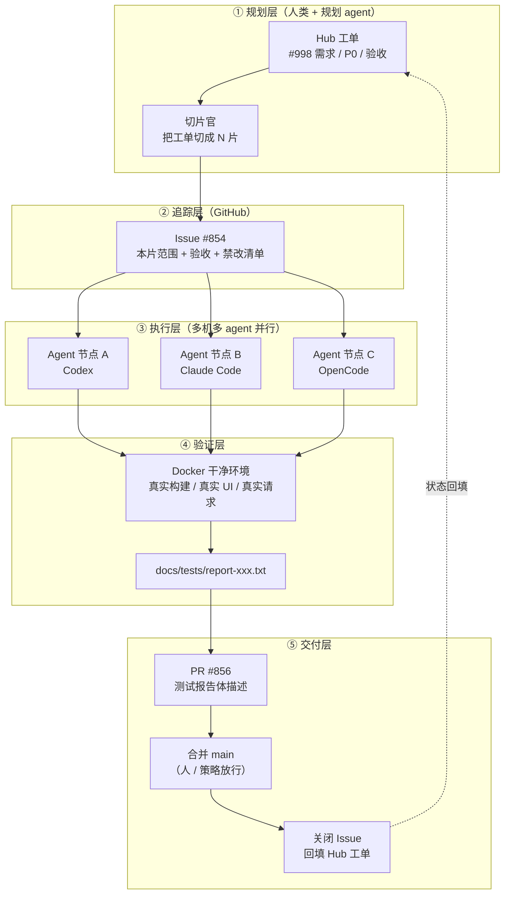

> **Playbook: Issue-Driven Multi-Agent Delivery Pipeline**
>
> 版本：v1.0 · 适用对象：希望用「任务切片 + 编码智能体 + 自动闭环」实现高吞吐开发的个人 / 小团队
>
> 参考原型：`sleep2agi/agent-network` 的公开工作流（Hub 工单 → 切片 issue → Codex / Claude Code 等 agent 执行 → Docker 内验证 → 测试报告体 PR → 自动合并 → 关闭 issue）

---

## 0. TL;DR（30 秒看懂）

1. **用一个「Hub 工单」承载需求**，把它切成 N 个可以独立闭环的「片（slice）」。
2. **每一片 = 一个 GitHub Issue**，Issue 描述里写死范围、验收标准、禁止事项。
3. **每个 Issue 交给一个编码智能体**（Codex / Claude Code / OpenCode / 任意 CLI agent），按固定 SOP 执行：建分支 → 写代码 → 在 Docker 里自测 → 生成测试报告 → 开 PR → 合并 → 关 Issue。
4. **PR 描述不是给人看的心情，是机器可核对的测试报告**（跑过哪些用例、几项通过、报告文件路径、边界声明）。
5. **多台机器 / 多个 agent 并行**，按目录或按模块认领切片，避免互相踩。
6. **数字是副产品**：一个切片自动产出 3~5 个 GitHub 贡献格子（1 Issue + 1 PR + 1~3 commit），一天 50~70 个切片就是单日 200~300 格贡献。

---

## 1. 这套流程到底在做什么

### 1.1 现象

某账号 GitHub 贡献图单日 200~300 次贡献，一年 7,655 次，构成大致是：

| 类型 | 占比 | 含义 |
|---|---|---|
| commits | ~58% | 分支提交 + 合入主干的 squash commit |
| pull requests | ~35% | 每个切片一个 PR |
| issues | ~7% | 每个切片一个 Issue（外加 Hub 工单） |
| code review | 0% | 人类不写 review（bot review 不计入人类贡献） |

### 1.2 本质

**不是人手速快，是「工作单元」被标准化后交给 agent 批量执行，人只做三件事：拆任务、定验收、合并放行。**

关键认知：

- GitHub 贡献图**把 commit / PR / issue / review 分别计数**。同一个工作单元会被重复计 3~5 次。
- 流水线是 **7×24** 运转的，人在睡觉时 agent 在跑。
- 质量不是靠「多看几遍」，而是靠**可复现的验证脚本 + 测试报告留痕**。

### 1.3 数字口径拆解（先算清楚再定目标）

一个「切片」典型产出：

```
1 个 Issue            = 1 格
1 次分支 commit       = 1 格
1 次合入 main 的 commit = 1 格
1 个 PR               = 1 格
────────────────────────────
合计                   ≈ 4 格（3~5 浮动）
```

| 目标 | 需要完成的切片 | 说明 |
|---|---|---|
| 单日 100 格 | ~25 片/天 | 单 agent + 人值班即可 |
| 单日 250 格 | ~60 片/天 | 2~4 个 agent 并行 + 自动合并 |
| 单日 300+ 格 | ~70 片/天 | 多机多 agent + 发布冲刺 |

> ⚠️ 贡献格子数 **≠** 产出价值。这套流程的正当目的是「吞吐」，不是「刷绿」。请把 §13 的质量门禁一起抄走，否则只是在批量制造垃圾。

---

## 2. 核心设计原则

| # | 原则 | 具体做法 |
|---|---|---|
| P1 | **片小到能一次闭环** | 每片 ≤ 500 行改动、≤ 2 小时 agent 时长、可独立合并 |
| P2 | **Issue 是唯一事实源** | 口头需求一律先落 Hub 工单，再切片；不接受「顺手改一下」 |
| P3 | **验收先行** | 写代码前先写「怎么算做完」（可执行的检查命令优先） |
| P4 | **验证必须可复现** | 一切验证跑在 Docker / 干净环境，命令写进脚本，结果写进报告文件 |
| P5 | **PR 描述 = 测试报告** | 机器可核对：跑了什么、通过几项、报告在哪、哪些没做 |
| P6 | **留痕优于口头** | 报告文件入库（`docs/tests/report-*.txt`），PR 描述引用路径 |
| P7 | **并行靠隔离** | 一片一目录 / 一片一模块；跨片共享文件必须串行加锁 |
| P8 | **合并权在人，节奏在机器** | agent 可以开 PR、跑验证，但合并按钮由人或显式策略放行 |
| P9 | **边界声明** | 每个 PR 写明「本次不做什么」，防止 agent 越权改生产配置 / 密钥 |
| P10 | **编号贯穿** | Hub 工单号出现在分支名、commit、PR 标题、报告文件名里，全链路可追溯 |

---

## 3. 总体架构

### 3.1 架构图



### 3.2 组件清单

| 组件 | 职责 | 可选实现 |
|---|---|---|
| Hub 工单库 | 需求、优先级、版本、验收 | GitHub Project / 独立 repo 的 issues / Notion / 飞书多维表 |
| 切片官 | 把工单切成可闭环的片 | 人类，或「规划型 agent + 人确认」 |
| 执行 agent | 建分支、写码、自测、开 PR | Codex CLI / Claude Code / OpenCode / Aider / 自研编排 |
| 验证环境 | 可复现的真实验证 | Docker Compose（推荐）/ 本地干净 VM / CI job |
| 报告留痕 | 测试结果存档 | `docs/tests/report-*.txt` 入库 |
| 自动化工具 | 建 issue / 开 PR / 合并 / 关 issue | `gh` CLI + 脚本 + GitHub Actions |
| 评审 bot | 机器预审 | `chatgpt-codex-connector` / GitHub Copilot code review / 自建 reviewer agent |
| 多机编排 | 并行派活 | `sleep2agi/agent-network`（参考实现）/ 自建队列（Redis 文件锁均可） |

### 3.3 建议目录结构

```text
your-repo/
├── .github/
│   ├── ISSUE_TEMPLATE/
│   │   ├── slice.yml            # 切片 Issue 模板
│   │   └── hub-ticket.yml       # Hub 工单模板
│   ├── PULL_REQUEST_TEMPLATE.md # 测试报告体 PR 模板
│   └── workflows/
│       ├── slice-verify.yml     # 每片验证流水线
│       └── auto-merge.yml       # 门禁通过后自动合并（可选）
├── docs/
│   ├── hub/                     # Hub 工单与切片台账
│   │   └── 998-reauth-loop.md
│   ├── tests/
│   │   └── report-test998-reauth-race.txt   # 测试报告留痕
│   └── playbooks/
│       └── agent-sop.md         # 本手册（仓库内副本）
├── scripts/
│   ├── slice-start.sh           # 开工：建分支
│   ├── slice-verify.sh          # 一键验证（本地 + Docker）
│   ├── slice-deliver.sh         # 开 PR + 合并 + 关 Issue
│   └── locks/                   # 目录级串行锁（并行防冲突）
├── AGENTS.md                    # 给 agent 的仓库规则（重要！）
├── CLAUDE.md                    # 各家 agent 的规则文件（按需）
└── ...
```

---

## 4. 前置准备

### 4.1 账号与权限

- [ ] 一个专用 GitHub 账号（可选，但推荐）：把「人类账号」与「流水线账号」分开，便于审计与限速隔离。
- [ ] 开启 GitHub 的 **noreply 邮箱**并配置到 git，确保 commit 计入贡献图：

```bash
git config --global user.name  "你的用户名"
git config --global user.email "你的ID+用户名@users.noreply.github.com"
# 邮箱可在 GitHub → Settings → Emails 查到，形如 25839884+username@users.noreply.github.com
```

- [ ] 仓库权限：流水线账号需要 `write`（开分支、推代码、开 PR）与 `triage`（开关 Issue）。合并权是否下放见 §13。
- [ ] 安装 GitHub CLI 并登录：

```bash
gh auth login
gh auth status
```

- [ ] 创建细粒度 PAT / 或直接用 `gh auth token`：scope 至少 `repo`、`workflow`（如需改 Actions）。
- [ ] 如使用 bot 评审：安装 `chatgpt-codex-connector` GitHub App 或 Copilot code review。

### 4.2 本机环境（每个 agent 节点都要有）

- git ≥ 2.40、Node.js ≥ 22（如用 Codex/OpenCode）、Python 3.11+（如需）
- Docker Desktop / Docker Engine（验证层必备）
- 一个编码 agent CLI 并完成登录（`codex login` / `claude auth login` 等）
- （可选）`jq`、`yq` 处理 JSON

> Windows 提示：建议在 **WSL2 或 Git Bash** 里跑脚本；PowerShell 也能用，但 bash 脚本可直接复用。下文命令以 bash 为主，PowerShell 等价写法见附录 B。

### 4.3 仓库初始化

**Labels（建议）**

```bash
gh label create slice        --color 0E8A16 --description "可闭环的切片"
gh label create hub/998      --color 1D76DB --description "属于 Hub 工单 998"
gh label create p0           --color D93F0B --description "P0"
gh label create needs-review --color FBCA04 --description "等待人工放行"
gh label create auto-merged  --color 5319E7 --description "门禁通过自动合并"
```

**Branch protection（`main`）**

- 至少要求：禁止 force push / 删除分支；PR 才能合入；状态检查 `slice-verify` 必须通过。
- 若允许「2/18 checks 通过就合」的高吞吐模式（见 §13.3），把必过检查收敛到 **1~2 个核心 job**（单测 + 类型检查），其余设为非阻塞。

**`AGENTS.md`（给所有 agent 的仓库宪法，务必写）**

```markdown
# AGENTS.md

## 必读
1. 只做当前 Issue「本片范围」内的事；发现别的问题 → 写进「遗留问题」，不要顺手修。
2. 禁止改动：生产配置、密钥、部署脚本、版本发布文件（除非 Issue 明确要求）。
3. 所有验证必须跑 `scripts/slice-verify.sh`，结果写入 `docs/tests/report-<slice>.txt`。
4. 提交信息格式：`type(scope): subject (#<hub>)`，一次切片 ≤ 3 个 commit。
5. PR 描述使用 `.github/PULL_REQUEST_TEMPLATE.md`，测试数字必须与报告文件一致。
6. 合并策略：不自己点合并，除非检查全部为绿且 Issue 标记 `auto-merge`。
```

### 4.4 一键自检脚本

```bash
#!/usr/bin/env bash
# scripts/preflight.sh —— agent 开工前自检
set -euo pipefail
command -v git  >/dev/null || { echo "缺 git";  exit 1; }
command -v gh   >/dev/null || { echo "缺 gh";   exit 1; }
command -v docker >/dev/null || { echo "缺 docker"; exit 1; }
gh auth status || { echo "gh 未登录"; exit 1; }
git config user.email >/dev/null || { echo "git 邮箱未配置"; exit 1; }
echo "OK: 环境就绪"
```

---

## 5. 工单体系（Hub）

### 5.1 三层结构

```
Hub 工单（需求/版本级，例：#998）
   └── 切片 Issue（可闭环交付，例：agent-network-app#854）
         └── PR（实现 + 测试报告，例：#856）→ 合并 → 关闭
```

一个 Hub 工单可以跨多个仓库切片（例：`#998` 同时切给 `agent-network` 与 `agent-network-app`），Hub 号要一路带到分支名与 PR 标题。

### 5.2 Hub 工单模板

```markdown
## Hub #<编号> · <一句话标题>
- 优先级：P0 / P1 / P2
- 目标版本：<如 0.2.241>
- 背景：<用户反馈 / 业务目标，3~5 行>
- 复现 / 现状：<怎么观察到问题的，包含环境>
- 总验收标准：
  - [ ] <可执行的验收 1>
  - [ ] <可执行的验收 2>
- 切片计划：
  - [ ] 片 1：<标题> → <目标 repo / 模块>
  - [ ] 片 2：<标题> → <目标 repo / 模块>
- 明确不做：<边界，防止蔓延>
- 发布要求：<版本号、必须从哪个 SHA 构建、灰度范围>
```

### 5.3 切片规则（怎么切才好闭环）

一条合格的切片 = **可独立合并 + 可独立验证 + 不依赖别的片**。

| 规则 | 说明 | 反例 |
|---|---|---|
| 一次只切一个行为 | 例：「修复过期 401 重登循环」是一片 | 「重构 auth 模块」太大 |
| 改动面可控 | ≤ ~500 行 diff、≤ 5 个文件为佳 | 一次 PR 30 个文件 |
| 验收可执行 | 「跑 `npm test -- reauth` 10/10 通过」 | 「体验流畅」 |
| 依赖显式 | 若依赖另一片，写明「先合片 N」 | 口头说「等他那个」 |
| 边界明确 | 写「不改 A、不动 B」 | 不写，agent 就乱动 |
| 命名带工号 | `fix/998-reauth-late-401` | `fix-bug2` |

### 5.4 切片 Issue 模板（`.github/ISSUE_TEMPLATE/slice.yml`）

```yaml
name: 切片（Slice）
description: 一个可独立闭环交付的工作片
title: "[slice] <标题> (#<hub>)"
labels: ["slice"]
body:
  - type: textarea
    id: hub
    attributes:
      label: 所属 Hub 工单
      description: 例：Hub #998（ANet / 知识库, P0）
    validations:
      required: true
  - type: textarea
    id: scope
    attributes:
      label: 本片范围（只做这些）
      placeholder: |
        1. …
        2. …
    validations:
      required: true
  - type: textarea
    id: accept
    attributes:
      label: 验收标准（可执行）
      placeholder: |
        - [ ] `scripts/slice-verify.sh <slice>` 全绿
        - [ ] Docker 内真实 UI 流程 8/8 PASS
    validations:
      required: true
  - type: textarea
    id: forbidden
    attributes:
      label: 禁止改动
      placeholder: |
        - 生产配置 / 密钥 / 部署脚本
        - 不创建真实生产数据
  - type: textarea
    id: env
    attributes:
      label: 复现与验证环境
      placeholder: Docker 镜像、账号要求、测试数据来源（推荐合成数据）
```

实际效果示例（节选自真实流水线）：

```markdown
Hub #998（ANet / 知识库, P0）。用户报告 Android 0.2.239 re-login 成功后又回到登录页；
冷启动能聊天但账号仍显示需重登。本片只做：凭据落盘后再接受替换、串行化 save/reauth 标记、
校验 request-token 归属、拦截 pending reauth 回调。验收：Docker core race 10/10、
session registry 39/39、password 66/66、全量 typecheck、真实导出 UI 8/8 PASS。
禁止：真实改密、原生打包、发布。下一版本 0.2.241 必须从 main 精确 SHA 构建。
```

### 5.5 状态流转

```text
Hub 工单:  Todo → Slicing → In Progress(片执行中) → Verify → Released → Closed
切片 Issue: Open → (agent 开工) → PR opened → Merged → Closed（由 PR 自动关闭）
```

用 `Closes #<issue>` 让 PR 合并时自动关 Issue；Hub 侧用脚本或 GitHub Project 自动化回填。

---

## 6. 命名与规范（全链路编号贯穿）

| 对象 | 格式 | 示例 |
|---|---|---|
| Hub 工单 | `Hub #<id>` | `Hub #998` |
| 切片 Issue 标题 | `[slice] <动词短语> (#<hub>)` | `[slice] stop stale401 re-login loop (#998)` |
| 分支名 | `<type>/<hub>-<slug>` | `fix/998-reauth-late-401` |
| commit | `<type>(<scope>): <subject> (#<hub>)` | `fix(auth): isolate late unauthorized responses from fresh sign-in (#998)` |
| PR 标题 | 与 commit 主题一致 | `fix(auth): stop stale401 re-login loop (#998)` |
| 测试报告 | `docs/tests/report-<topic>-<slug>.txt` | `docs/tests/report-test998-reauth-race.txt` |
| 发布分支 | `release/<hub>-<描述>` | `release/906-provider-pair-166-132-124` |
| 运维分支 | `ops/<hub>-<描述>` | `ops/906-hub121-preflight` |

**commit type 对照**：`feat` `fix` `refactor` `test` `docs` `ci` `chore` `perf` `build`

**红线**：

1. 分支名、commit、PR 标题、报告文件名里都必须出现 Hub 编号（追溯性）。
2. 一次切片 ≤ 3 个 commit；超过说明片切大了。
3. 禁止 `update` / `fix bug` / `wip` 这类 commit message。

---

## 7. 单个切片的标准作业流程（SOP）

> 目标：一个熟练的 agent + 本 SOP，能在 **30~90 分钟**内闭环一片。下表是时间预算。

| 步骤 | 动作 | 输入 | 输出 | 预算 |
|---|---|---|---|---|
| S0 | 前置自检 | Issue | 环境 OK | 2 min |
| S1 | 认领切片 | Issue 列表 | 拿到锁、贴认领评论 | 1 min |
| S2 | 精读 Issue | Issue | 明确范围/验收/禁改 | 5 min |
| S3 | 建分支 | 分支规范 | `fix/998-xxx` | 1 min |
| S4 | 先写验证 | 验收标准 | 失败的测试/脚本 | 10 min |
| S5 | 实现 | 范围 | diff | 20~40 min |
| S6 | Docker 内验证 | `slice-verify.sh` | 全绿 | 10~20 min |
| S7 | 生成测试报告 | 验证输出 | `report-*.txt` | 5 min |
| S8 | 自查（边界/遗留） | diff | 自查清单 | 5 min |
| S9 | 开 PR | 模板 | PR（测试报告体） | 3 min |
| S10 | 机器评审 | bot | 无阻塞意见 / 修复 | 5~15 min |
| S11 | 合并放行 | 门禁 | merge 到 main | 1~5 min |
| S12 | 收尾 | merge | 关 Issue、回填 Hub、删分支、记录度量 | 3 min |

### S1 认领切片（并行防冲突）

```bash
gh issue comment <n> --body "🔧 claimed by <agent-id> on <host> at $(date -u +%FT%TZ)"
# 或用文件锁（见 §12）
```

### S3 建分支

```bash
git checkout main && git pull --ff-only
git checkout -b fix/998-reauth-late-401
```

### S4 先写验证（非常重要）

- 把验收标准翻译成**可执行命令**：单测、脚本、UI 步骤清单。
- 跑一遍，**确认当前是失败的**（红），再开始写代码。这一步防止「测了个寂寞」。

### S6 Docker 内验证（推荐形态）

```yaml
# docker/verify.compose.yml
services:
  verify:
    build: .
    volumes:
      - ./docs/tests:/app/docs/tests
    command: bash scripts/slice-verify.sh <slice>
    environment:
      - VERIFY_MODE=docker          # 强制干净环境
      - SYNTHETIC_CREDENTIALS=1     # 只用合成凭据
```

```bash
docker compose -f docker/verify.compose.yml run --rm verify
```

验证内容建议覆盖（按项目裁剪）：

- [ ] 单元测试（按模块统计，如 `session registry 39/39`）
- [ ] 竞态/回归专项（如 `core race 10/10`）
- [ ] 全量类型检查 / lint
- [ ] 真实构建（真实导出、真实打包，而不是 mock）
- [ ] 关键路径 UI/接口冒烟（如 `login/late401 UI 8/8`）
- [ ] 边界确认：未触碰禁改文件（`git diff --name-only` 对照清单）

### S8 自查清单

```markdown
- [ ] diff 里没有超出「本片范围」的改动
- [ ] 没有密钥、生产配置、真实用户数据
- [ ] 测试数字与报告文件一致
- [ ] 报告文件已入库并被 PR 引用
- [ ] 遗留问题已写进 PR「遗留问题」小节（而不是顺手改）
- [ ] commit 数 ≤ 3，信息符合规范
```

### S12 收尾

```bash
gh pr merge <n> --squash --delete-branch   # 或由自动合并完成
gh issue close <issue> --comment "已完成，报告：docs/tests/report-xxx.txt"
# 回填 Hub 台账：把片标为 Done
```

---

## 8. 自动化脚本

### 8.1 `scripts/slice-start.sh`（开工）

```bash
#!/usr/bin/env bash
set -euo pipefail
ISSUE="${1:?用法: slice-start.sh <issue号> <hub号> <slug>}"
HUB="${2:?hub 号}"
SLUG="${3:?slug}"
BR="fix/${HUB}-${SLUG}"

bash scripts/preflight.sh
git checkout main && git pull --ff-only
git checkout -b "$BR"

gh issue comment "$ISSUE" --body "🔧 开工：分支 \`${BR}\`，agent=$(hostname) $(date -u +%FT%TZ)"
echo "OK: 分支 $BR 已就绪"
```

### 8.2 `scripts/slice-verify.sh`（一键验证）

```bash
#!/usr/bin/env bash
set -euo pipefail
SLICE="${1:?用法: slice-verify.sh <slice名>}"
OUT="docs/tests/report-${SLICE}.txt"
mkdir -p docs/tests
: > "$OUT"

run() {  # run <名称> <命令...>
  local name="$1"; shift
  echo "== ${name}" | tee -a "$OUT"
  if "$@" >>"$OUT" 2>&1; then
    echo "   PASS ${name}" | tee -a "$OUT"
  else
    echo "   FAIL ${name}" | tee -a "$OUT"; exit 1
  fi
}

{
  echo "Report: ${SLICE}"
  echo "Date(UTC): $(date -u +%FT%TZ)"
  echo "SHA: $(git rev-parse HEAD)"
  echo "Env: ${VERIFY_MODE:-local} | synthetic-credentials=${SYNTHETIC_CREDENTIALS:-0}"
} >> "$OUT"

run "typecheck"      npm run typecheck
run "unit-core"      npm test -- --grep "core race"
run "unit-session"   npm test -- --grep "session registry"
run "unit-password"  npm test -- --grep "password"
run "ui-smoke"       bash scripts/ui-smoke.sh

echo | tee -a "$OUT"
echo "ALL PASS — see ${OUT}" | tee -a "$OUT"
```

### 8.3 `scripts/slice-deliver.sh`（开 PR → 合并 → 关闭）

```bash
#!/usr/bin/env bash
set -euo pipefail
ISSUE="${1:?issue 号}"; HUB="${2:?hub 号}"; REPORT="${3:?报告路径}"
TITLE="${4:?PR 标题，形如 fix(auth): ... (#998)}"

git push -u origin HEAD

gh pr create \
  --title "$TITLE" \
  --body-file .github/PULL_REQUEST_TEMPLATE.md \
  --label "slice,needs-review"

# 门禁：只有 checks 全绿才允许合并
gh pr checks --watch || { echo "checks 未通过，拒绝合并"; exit 1; }
gh pr merge --squash --delete-branch
gh issue close "$ISSUE" --comment "✅ 已合并。报告：${REPORT}（Hub #${HUB}）"
```

### 8.4 全自动模式（可选，谨慎使用）

思路：Issue 打上 `slice` + `auto-merge` 标签 → Actions 触发 agent → agent 推分支开 PR → checks 绿 → auto-merge。

```yaml
# .github/workflows/auto-merge.yml
name: auto-merge
on:
  pull_request:
    types: [opened, synchronize, reopened]
permissions:
  contents: write
  pull-requests: write
jobs:
  merge:
    if: contains(github.event.pull_request.labels.*.name, 'auto-merge')
    runs-on: ubuntu-latest
    steps:
      - uses: actions/checkout@v4
      - name: Wait core checks
        run: bash scripts/wait-checks.sh --required slice-verify
      - name: Merge
        run: gh pr merge ${{ github.event.pull_request.number }} --squash --auto
        env:
          GH_TOKEN: ${{ secrets.GH_TOKEN }}
```

> ⚠️ **全自动合并必须有门禁**：核心检查（单测 + typecheck）红了就停；`security`、`sbom` 等检查可设为非阻塞以保证吞吐，但要有定期人工巡检（§15）。

---

## 9. 测试报告规范（`docs/tests/report-*.txt`）

**为什么入库**：PR 描述可以改，报告文件在 git 历史里不可抵赖；出问题时可回溯「当时到底测了什么」。

**报告必须包含**：

```text
Report: test998-reauth-race
Date(UTC): 2026-10-11T12:31:04Z
SHA: 557cadd963...
Env: docker | synthetic-credentials=1
Scope: Hub #998 / slice: stale-401 re-login loop

== typecheck
   PASS typecheck
== unit-core (race)
   10/10 PASS
== unit-session (registry)
   39/39 PASS
== unit-password
   66/66 PASS
== ui-smoke (fresh Expo export: storage / login / late-401)
   8/8 PASS

Boundary:
- 未做真实改密（合成凭据）
- 未做原生打包 / 发布
- 未触碰生产配置

ALL PASS
```

**硬性要求**：

1. 数字必须与 PR 描述一致（不一致 = 自动退回）。
2. 必须写 **Boundary（边界/未做事项）**。
3. 必须写 **SHA**，保证报告对应确切代码。
4. 只用合成凭据 / 测试数据，禁止真实生产数据进报告。

---

## 10. PR 描述模板（`.github/PULL_REQUEST_TEMPLATE.md`）

```markdown
## 关联
Closes #<issue>. Hub #<hub> <优先级>.

## 问题与复现
<一两句；如有复现，写「pre-fix 复现观察到 X，修复后为 Y」>

## 本片改动
- <改动 1：做了什么 + 为什么>
- <改动 2>
- <保留行为：哪些既有行为被刻意保留（如 legacy 兼容）>

## 验证（与报告文件一致）
- <测试 A> <n>/<n> PASS
- <测试 B> <n>/<n> PASS
- 全量 typecheck PASS
- <真实构建/真实 UI> <n>/<n> PASS
- Report: `docs/tests/report-<name>.txt`

## 边界（本次不做）
- 合成凭据；无真实 <生产操作>
- 未做 <打包 / 发布 / 迁移>
- 遗留问题：<列出，不顺手修>

## 发布要求
- 下一版本 <x.y.z> 必须从 main 精确 SHA `<sha>` 构建
```

真实范例（可直接套的语言风格）：

> Closes #854. Hub #998 P0. Actual pre-fix Docker repro observes two redirects instead of one after a fresh credential save. Narrow fix accepts replacement credentials only after persistence, serializes credential save/reauth marks, verifies request-token ownership, and guards pending reauth callbacks. Keeps genuine current-token 401, legacy identity and password rotation. Docker core race 10/10, session registry 39/39, password 66/66, full typecheck and drive registry 12/12 PASS. Fresh actual Expo export + mobile storage/login/late-401 UI 8/8 PASS. Report: docs/tests/report-test998-reauth-race.txt. Synthetic credentials only; no production password change, native installation or publication. Planned next client version 0.2.241 must be built from exact main SHA.

---

## 11. Agent 提示词模板库

### 11.1 切片官（规划 agent）

```text
你是切片官。把下面的 Hub 工单切成可独立闭环的片。
每片输出：标题、目标仓库/模块、范围（≤5 条）、验收（可执行命令）、禁止改动、依赖。
规则：
- 每片 diff ≤ 500 行、≤ 2 小时工作量、可独立合并。
- 相互依赖的片要排序；共享同一文件的片必须串行。
- 不要切出「重构一切」这类大而空的片。
输出为 markdown 表格 + 每片的 Issue 正文草稿。
<粘贴 Hub 工单>
```

### 11.2 执行者（编码 agent）

```text
你是执行 agent，负责完成 Issue #<n>（Hub #<hub>）这一个切片。

规则（必须遵守）：
1. 只做「本片范围」内的事。范围外的问题写入 PR 的「遗留问题」，不要改。
2. 禁止改动：生产配置、密钥、发布脚本；禁止创建真实生产数据。
3. 流程固定：pretest（先写会失败的验证）→ 实现 → scripts/slice-verify.sh <slice> →
   报告写入 docs/tests/report-<name>.txt → 自查 → 开 PR（用模板）。
4. commit ≤ 3 个，格式 type(scope): subject (#<hub>)；分支 <type>/<hub>-<slug>。
5. 测试数字必须与报告文件一致；不得虚构数字。

完成标准：PR 已开、报告已入库、边界已声明、自查清单全勾。
如果验证无法通过，停止并报告阻塞原因，不要用「跳过测试」的方式强行完成。
```

### 11.3 评审者（review agent / bot）

```text
你是评审 agent。只做三类检查，输出结论（BLOCK / WARN / PASS）：
1. 范围越界：diff 是否超出 Issue 的「本片范围」？是否碰了禁改文件？
2. 真实性：PR 中的测试数字与 docs/tests/report-*.txt 是否一致？报告是否含 SHA 与 Boundary？
3. 风险：密钥/生产数据/破坏性操作；明显的竞态、错误处理缺失、兼容性破坏。
不要提出重构美学建议。每条意见标注文件:行号与建议补丁（可选）。
```

### 11.4 验收者（对 Hub 工单）

```text
对照 Hub #<hub> 的「总验收标准」逐条核验：
- 每条给出证据（commit / 报告路径 / 复现步骤与结果）
- 全部满足 → 输出「可发布」，附建议版本号与构建 SHA
- 任一不满足 → 列出缺口与所需补片
```

### 11.5 发布官

```text
基于 main 的精确 SHA <sha> 出版本 <x.y.z>：
- 核对 CHANGELOG（从 Hub 工单与合并的 PR 汇总）
- 核对「边界声明」中承诺的未做事项已登记
- 打 tag、生成发布说明、把 Hub 工单状态置为 Released
- 全程不改代码；发现问题开新 Hub 工单
```

---

## 12. 多 Agent 并行与冲突控制

### 12.1 隔离策略（按优先级）

1. **仓库级隔离**：一片一个仓库（天然无冲突）。
2. **目录级隔离**：每片主要改动限定在一个目录（`server/`、`channel/`、`docs-site/`…）。
3. **文件级锁**：共享文件（如 `CHANGELOG.md`、`package.json`）用锁串行。

### 12.2 文件锁实现（最简版）

```bash
# scripts/lock.sh —— 用 git 仓库里的锁目录实现跨机器锁
acquire() {
  local key="$1"
  if mkdir "scripts/locks/${key}" 2>/dev/null; then
    echo "$(hostname) $(date -u +%FT%TZ)" > "scripts/locks/${key}/owner"
    git add "scripts/locks/${key}" && git commit -m "chore(lock): acquire ${key}" && git push
  else
    echo "锁被占用: $(cat scripts/locks/${key}/owner 2>/dev/null)"; exit 2
  fi
}
release() {
  local key="$1"
  git rm -r "scripts/locks/${key}" && git commit -m "chore(lock): release ${key}" && git push
}
```

> 更稳妥的方案：中心队列（Hub/CommHub 派活）、数据库行锁、或直接用 `sleep2agi/agent-network` 这类多 agent 编排（自带派活与节点发现）。

### 12.3 并行度建议

| 场景 | 并行 agent 数 | 说明 |
|---|---|---|
| 同一仓库、目录隔离好 | 2~4 | 超过 5 个合并冲突成本剧增 |
| 同一文件频繁共享 | 1 | 串行，别硬并行 |
| 多仓库 | 每仓库 1~3 | 最舒服的形态 |
| 发布前冻结期 | 0~1 | 只修 P0，禁止新片 |

---

## 13. 质量门禁与合并策略

### 13.1 门禁分级

| 级别 | 必须通过 | 何时可放宽 |
|---|---|---|
| **G0 核心门禁**（阻塞） | 单测核心套件、typecheck、diff 范围检查、报告一致性 | 任何情况都不可放宽 |
| **G1 重要门禁**（阻塞可配） | lint、集成测试、UI 冒烟 | 高吞吐期可设非阻塞，但必须在同日补跑 |
| **G2 外围检查**（非阻塞） | SBOM、覆盖率、全矩阵 E2E、多平台构建 | 平时非阻塞，发布前全绿才发版 |

### 13.2 「高吞吐合并」的真实做法

公开流水线里出现过 **`2 of 18 checks passed` 就合并**的情况。可复刻但要设护栏：

1. 把 **G0 收敛到 1~2 个 job**（< 5 分钟跑完），合并只等 G0。
2. G1/G2 放到合并后的 `main` 上继续跑（merge queue / 后置流水线），红了立即回滚或补片。
3. 每日固定时间人工巡检 `main` 的后置检查结果（§15）。
4. **P0/P1 影响面大的片禁止走高吞吐通道**，必须 G0+G1 全绿 + 人审。

### 13.3 合并策略选择

| 策略 | 优点 | 缺点 | 适用 |
|---|---|---|---|
| 人手点合并 | 最安全 | 瓶颈 | 起步期 |
| `gh pr merge --auto`（checks 绿自动合） | 吞吐高、有门禁 | 需要稳定的 G0 | **推荐** |
| 完全自动（agent 自己合） | 吞吐最高 | 风险最高 | 仅限低风险仓库 + 强边界 |

> 无论哪种，**squash 合并** + PR 标题带 Hub 编号，能让 `main` 历史干净可追溯。

---

## 14. 真实时间线复刻示例

以 UTC 时间还原一条「片」的完整节奏（节选自公开活动流）：

```text
04:21  push  ops/906-hub121-preflight   ci: run narrow Hub deployment-profile check
05:18  PR #853 opened → 30s 后 merged → issue #852 closed
05:23  issue #854 opened（Hub #998 P0，切片）
05:30  push  release/906-...  2 commits（发版准备）
05:30  PR #2600 merged（+502/-7）
05:33  PR #856 opened（+236/-15，测试报告体描述）
05:34  PR #856 merged → issue #854 closed   ← 开 PR 到合并 30 秒
```

**可复刻的节奏要点**：

- Issue→PR 约 **10 分钟**（agent 实现 + Docker 验证）。
- PR→merge 约 **30 秒**（等 G0 通过即合，不等全量 CI）。
- 多个仓库/分支同时推进（`ops/*`、`release/*`、`fix/*` 交错）。
- 每个 PR 都带 `Closes #<issue>`，关闭动作零人工。

**一天的排布建议**：

```text
00:00-02:00  agent 批量处理 P1/P2 片（人睡觉）
09:30        人：看日报、放行积压 PR、裁决遗留问题
10:00-12:00  冲刺 P0 片（人机协同，人在场）
14:00        人：切新片、更新 Hub 工单
15:00-19:00  agent 并行闭环（人抽查 PR）
21:00        巡检 main 后置检查、生成日报、冻结或放行
```

---

## 15. 监控、度量与日报

### 15.1 日报模板

```markdown
# 流水线日报 <日期>
## 吞吐
- 闭环切片：<n>（P0 <a> / P1 <b> / P2 <c>）
- 合并 PR：<n>；平均 PR→merge：<sec>s；平均 Issue→PR：<min>min
- 贡献格子：<n>（issue <i> / pr <p> / commit <c>）
## 质量
- G0 红灯次数：<n>；回滚：<n>
- 后置检查（G1/G2）未通过但已合并：<n> → 处理：<补片/回滚/忽略原因>
- 机器评审 BLOCK：<n>，采纳率：<%>
## 风险与遗留
- <遗留问题 1：出处、影响、建议>
## 明日计划
- <Hub 工单 → 计划切片>
```

### 15.2 关键指标

| 指标 | 公式 | 健康值参考 |
|---|---|---|
| 切片吞吐 | 闭环片数/天 | 起步 10，成熟 40~70 |
| 闭环时长 | Issue 创建 → merge | < 90 min |
| 一次通过率 | 不需要返工的片 / 总片 | > 70% |
| 返工率 | 被 revert / 补片 / 复开 | < 10% |
| 越界率 | 评审 BLOCK 中「范围越界」占比 | < 5%，否则切片规则要改 |
| 报告一致性 | 抽查 PR 数字 vs 报告文件 | 100%（必须） |
| 贡献格子 | 见 §1.3 | 副产品，不作为 KPI |

### 15.3 周度审计（人必须做）

- [ ] 随机抽 3 个 PR，核对报告文件与实际 diff 是否一致
- [ ] 检查是否有「遗留问题」堆积未处理
- [ ] 检查 `main` 后置检查（G1/G2）连续红灯
- [ ] 检查是否有密钥/生产数据误入仓库（secret scanning）
- [ ] 复盘 1 个失败切片，更新 `AGENTS.md` 或 SOP

---

## 16. 常见坑与风险清单

| # | 坑 | 后果 | 对策 |
|---|---|---|---|
| 1 | commit 邮箱未绑定账号 | 干了很多活，贡献图不亮 | 用 noreply 邮箱，先用 1 个测试 commit 验证 |
| 2 | 片切太大 | agent 跑偏、返工、PR 无法评审 | §5.3 切片规则，>500 行强制拆 |
| 3 | agent 越权改生产配置/密钥 | 事故 | `AGENTS.md` 禁改清单 + diff 范围检查 + secret scanning |
| 4 | 测试数字造假（agent 幻觉） | 信任崩塌 | 报告文件入库 + 报告一致性抽查 + 验证脚本由人维护 |
| 5 | 并行冲突 | 合并地狱 | §12 隔离 + 锁；共享文件串行 |
| 6 | 自动合并无门禁 | 垃圾代码进 main | G0 必须存在且 < 5 分钟 |
| 7 | CI 未过就合 | 隐性故障 | 高吞吐通道仅限低风险片；P0 全绿 + 人审 |
| 8 | 用真实生产数据验证 | 合规/隐私风险 | 只用合成凭据与测试数据（写进 Boundary） |
| 9 | 提交信息混乱 | 无法追溯 | commit 规范 + Hub 编号贯穿 |
| 10 | fork 仓库的 commit 不计贡献 | 白干 | 在自己有权限的仓库/主仓库上工作 |
| 11 | 时区导致贡献落到别天 | 图不好看 | 贡献图按 UTC-8 切日；如在意，注意提交时间 |
| 12 | 只看格子不看价值 | 被反噬（刷绿嫌疑） | §1.3 + §15 度量以「闭环片/一次通过率」为准 |
| 13 | agent 全自动无人值班 | 事故无人兜底 | 保留人工放行点（§13.3）+ 日报巡检 |
| 14 | 遗留问题被「顺手修」 | 范围蔓延、回归 | 遗留问题登记制，开新片再修 |

---

## 17. 落地路线图

### Day 1：最小闭环（1 个 agent，手放行）

- [ ] 配好 git 邮箱、`gh` 登录、Docker
- [ ] 建 `AGENTS.md`、PR 模板、Issue 模板
- [ ] 写 `slice-verify.sh`（哪怕只有 3 条检查）
- [ ] 手动切 1 个片 → agent 执行 SOP → 人手合并
- [ ] 验证贡献格子次日正确显示（校准计数口径）

### Day 2-3：半自动

- [ ] 补齐 `slice-start.sh` / `slice-deliver.sh`
- [ ] 引入机器评审 bot（Codex / Copilot review）
- [ ] 配置 G0 检查 + `gh pr merge --auto`
- [ ] 切 5~10 个片跑通，测量「Issue→PR」「PR→merge」时长

### Week 2：并行与冲刺

- [ ] 多机/多 agent 并行，接入隔离与锁策略
- [ ] Hub 工单台账 + 日报自动生成
- [ ] 设定门禁分级（G0/G1/G2）与高吞吐通道适用范围
- [ ] 复盘越界率与返工率，迭代 `AGENTS.md` 规则

### Month 1+：稳态

- [ ] 40~70 片/天稳定吞吐，一次通过率 > 70%
- [ ] 周度审计机制固化
- [ ] 需要时参考/接入多 agent 编排（`sleep2agi/agent-network`：多机节点、MCP 派活、Web Dashboard）

---

## 附录 A · 命令速查

```bash
# 环境
bash scripts/preflight.sh

# 开工
bash scripts/slice-start.sh 854 998 reauth-late-401

# 验证（本地 / Docker）
bash scripts/slice-verify.sh test998-reauth-race
docker compose -f docker/verify.compose.yml run --rm verify

# 交付
bash scripts/slice-deliver.sh 854 998 docs/tests/report-test998-reauth-race.txt \
  "fix(auth): stop stale401 re-login loop (#998)"

# gh 常用
gh issue create --title "[slice] ..." --label slice
gh pr create --title "..." --body-file .github/PULL_REQUEST_TEMPLATE.md
gh pr checks --watch
gh pr merge <n> --squash --delete-branch --auto
gh issue close <n> --comment "✅ ..."
gh pr list --author "@me" --state merged --json number,title,mergedAt
```

## 附录 B · PowerShell 等价写法（节选）

```powershell
# 开工
git checkout main; git pull --ff-only
git checkout -b "fix/998-reauth-late-401"
gh issue comment 854 --body "开工：fix/998-reauth-late-401"

# 验证
$env:VERIFY_MODE = "docker"
bash scripts/slice-verify.sh test998-reauth-race   # 或把脚本改写为 .ps1

# 交付
git push -u origin HEAD
gh pr create --title "fix(auth): stop stale401 re-login loop (#998)" --body-file .github/PULL_REQUEST_TEMPLATE.md
gh pr checks --watch
gh pr merge --squash --delete-branch --auto
```

## 附录 C · 模板文件清单（一次建齐）

- [ ] `AGENTS.md` —— agent 仓库宪法
- [ ] `.github/PULL_REQUEST_TEMPLATE.md` —— 测试报告体 PR 模板
- [ ] `.github/ISSUE_TEMPLATE/slice.yml` —— 切片模板
- [ ] `.github/ISSUE_TEMPLATE/hub-ticket.yml` —— Hub 工单模板
- [ ] `.github/workflows/slice-verify.yml` —— G0 检查
- [ ] `.github/workflows/auto-merge.yml` —— 自动合并（可选）
- [ ] `scripts/preflight.sh` / `slice-start.sh` / `slice-verify.sh` / `slice-deliver.sh`
- [ ] `docker/verify.compose.yml` —— 干净验证环境
- [ ] `docs/hub/`、`docs/tests/` —— 工单台账与报告留痕

## 附录 D · 术语表

| 术语 | 含义 |
|---|---|
| Hub 工单 | 需求/版本级任务，跨仓库、跨切片的父级编号 |
| 片（Slice） | 可独立闭环交付的最小工作单元 = 1 个 Issue |
| 闭环 | 从 Issue 创建到 PR 合并、Issue 关闭的完整链路 |
| G0/G1/G2 | 门禁分级：核心阻塞 / 重要 / 外围非阻塞 |
| 测试报告体 PR | 以「跑了什么、过几项、报告在哪、不做啥」为主体的 PR 描述 |
| Boundary | 边界声明：本次明确不做的事 |
| 贡献格子 | GitHub 贡献图上的一个计数单位（commit/PR/issue 分别计） |

---

## 最后一句

这套流程的**真正产出不是绿格子，而是「可追溯、可验证、可复盘」的交付链路**。
先跑通「1 片闭环」，再谈「一天几百」。吞吐是自动化的副产品，质量才是这套系统存在的理由。
